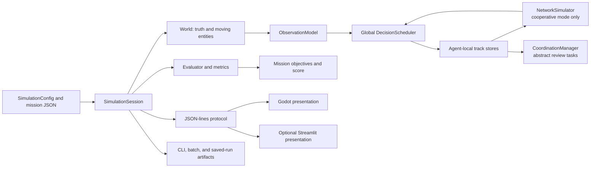
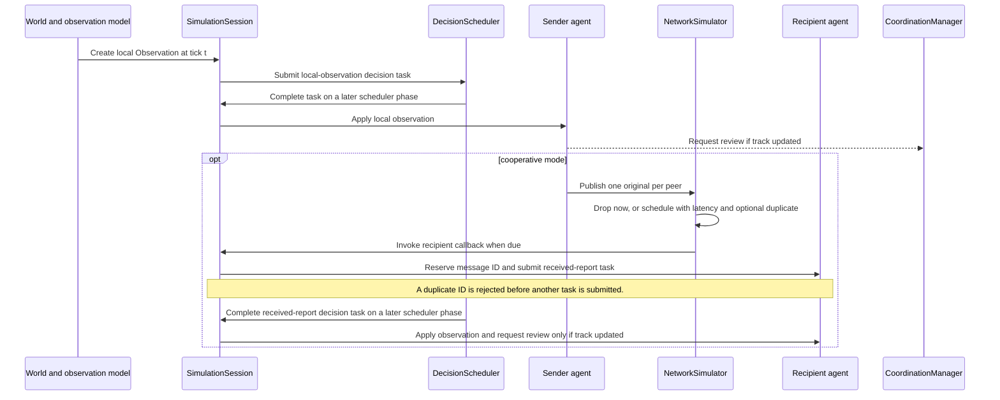

# SwarmShield Coordination and Communication Architecture

This guide describes the coordination, information-sharing, task-processing, and evaluation behavior implemented by the current Python simulation engine. It is intended to help researchers and developers interpret a run, reproduce it, and distinguish implemented behavior from future extensions.

The Python engine is authoritative. Godot and the optional Streamlit app present engine state; the CLI and batch tools call the same engine. “Agent”, “communication”, “coordination”, and “task” below refer to the project's synthetic simulation abstractions. They do not imply physical UAV networking, flight control, or operational command behavior.

## 1. Scope and model boundary

The engine simulates a bounded 2D world, destination-driven UAV motion, moving synthetic entities, noisy local detections, per-agent tracks, an in-process message queue, a global logical-work scheduler, abstract review assignment, and spatial mission tasks. Logical time advances only when `SimulationSession.advance_tick()` is called. Rendering frame rate and wall-clock scheduling do not advance the model. The Godot mission protocol allocates spatial mission tasks at start and runs the modular assigned-task behavior policy; generic headless sessions without mission tasks still require explicit route commands.

Exact entity positions are held by `World` and exposed to the evaluator and render snapshots. An agent's decision path receives `Observation` objects generated through the observation model, not exact entity state. Each agent stores its own track per entity. Cooperative mode sends observations through the simulated network to the other agents; independent mode does not publish peer reports.

The model has deterministic UAV kinematics, deterministic grid A* route planning, waypoint following, blocked-route replanning, and configurable heading/FOV/line-of-sight sensing. The Godot mission protocol allocates spatial mission tasks at run start and runs `AssignedMissionBehavior`, which plans obstacle-aware routes and returns low-battery UAVs to configured safe areas; generic headless sessions without mission tasks still require explicit route commands through `SimulationSession.assign_destination()`. Player destination and reassignment actions pass through Python validation and are recorded. The model has no operational radio/socket transport, spatial network topology, bandwidth, or hop-based retransmission protocol. The Godot map draws terrain and obstacle art from backend geometry. These staged model limits are described below.

## 2. Components and data flow

| Component | Responsibility | Important boundary |
|---|---|---|
| `World` | Owns entity truth, initial UAV spawn positions, protected zone, static geometry, and entity movement. | Agent logic gets generated observations; the evaluator and snapshot renderer can read truth. |
| `ObservationModel` | Applies range, heading-relative field of view, configured line-of-sight occlusion, Bernoulli detection, Gaussian position noise, and map-bound clamping. | It generates no false positives and assigns fixed confidence `1.0`. |
| `Agent` | Stores one latest accepted track per entity and message IDs already reserved for reception. | Tracks are not fused, extrapolated, or probabilistically filtered. |
| `NetworkSimulator` | Creates one original envelope per recipient, simulates loss, latency, duplication, partitions, delivery, and event records. | This is an in-process logical model, not a real network stack. |
| `DecisionScheduler` | Stores and orders local-observation and received-report work against logical capacity and deadlines. | One global queue is shared by all agents; work units are synthetic and not CPU time. |
| `CoordinationManager` | Creates one generic review task per first-tracked entity and assigns it to abstract agent resources. | Assignment does not move an agent, change a track, or perform a physical action. |
| `SimulationSession` | Owns the run, deterministic RNG streams, tick ordering, interventions, metrics, events, and finalization. | The CLI runner repeatedly calls this same session implementation. |
| Mission and artifact code | Evaluates configured objectives, calculates a weighted score, and writes JSON/CSV run artifacts. | The mission result is derived from the finalized session summary, not UI state. |

Relevant implementation: [`world.py`](../swarmshield/world.py#L38), [`observations.py`](../swarmshield/observations.py#L26), [`agents.py`](../swarmshield/agents.py#L11), [`network.py`](../swarmshield/network.py#L12), [`scheduler.py`](../swarmshield/scheduler.py#L24), [`coordination.py`](../swarmshield/coordination.py#L22), and [`session.py`](../swarmshield/session.py#L22).

## 3. Agent knowledge and track updates

An `Observation` contains:

| Field | Meaning |
|---|---|
| `entity_id` | Synthetic entity identity. |
| `x`, `y` | Noisy, clamped observed position. |
| `observed_at` | Logical tick at which the local sensor generated the report. |
| `source_agent_id` | Agent whose local sensor produced the report. |
| `confidence` | Fixed at `1.0`; the current model does not vary it with range or noise. |

Each agent's `tracks` dictionary is keyed by `entity_id`, so at most one `Track` for each entity is retained per agent. A newer observation timestamp replaces an older one. An older report returns `stale` and is ignored. At the same timestamp, a report whose confidence is not higher returns `unchanged`; a higher-confidence report replaces it. This is timestamp-based replacement, not multi-source fusion: when timestamps differ, confidence does not compete with freshness.

A track is fresh at tick `t` when `t - observed_at <= max_track_age_steps`; the boundary is inclusive. Stale tracks remain stored and can appear in an inspector, but active-track metrics and final coverage exclude them. A report may also be current locally but absent from peers because sharing is disabled, a message was lost, a report task was rejected, or its decision work has not completed.

Local observation generation uses Euclidean distance to the exact synthetic entity position. Out-of-range entities are skipped. A target must also be inside the configured heading-relative field of view and, when enabled, have a clear segment under `World.has_line_of_sight()`. The field of view is centered on the UAV's current simulated heading; positive Y points down. LOS checks configured obstacles and vegetation marked `blocks_line_of_sight`, with obstacle boundaries treated as occluding. After these geometric checks, each eligible entity is detected when the observation RNG draw is below `detection_probability`. Position x and y receive independent Gaussian noise with standard deviation `position_noise_std` and are clamped to `[0, world_width]` and `[0, world_height]`. There are no false detections. Reports retain fixed confidence `1.0`; noise does not yet produce an uncertainty estimate. Entity velocity is independently initialized in `[-1, 1]` for each axis and reflected at world bounds.

The map's live snapshot intentionally contains exact entity positions for drawing, while tracks carry the agent's estimates. Do not interpret the renderer's synthetic-entity positions as information available to the agents. See [`observations.py`](../swarmshield/observations.py#L43), [`agents.py`](../swarmshield/agents.py#L47), and [`world.py`](../swarmshield/world.py#L83).

## 4. Message model and lifecycle

### 4.1 Envelope

The in-memory immutable `Envelope` consists of:

| Field | Meaning |
|---|---|
| `message_id` | Sequential ID such as `msg-00000001`; an original and any duplicate copy share it. |
| `protocol_version` | Integer message-schema version (`1` currently), separate from the JSON-lines adapter version. |
| `message_type` | `observation` for the currently implemented payload. Unsupported types are rejected by the session receiver. |
| `sender_id` | Agent whose local report was shared. |
| `recipient_id` | One receiving agent. The network creates a separate original for each recipient. |
| `observation` | The original observation payload, including source and observation tick. |
| `sent_step` / `created_step` | Logical tick at publication; `created_step` is the serialized name for the same value. |
| `delivery_step` | Scheduled due tick, `sent_step + sampled_latency`. |
| `valid_until_step` | Optional inclusive validity deadline. An envelope expires on the first tick after this value. |
| `provenance` | Original observation source agent and `observed_at` tick, preserved even if another agent sends it. |
| `copy_index` | `0` for the original; `1` for the optional duplicate copy. |
| `attempt` | Zero-based delivery attempt; retries retain the same message ID. |

`Envelope.to_dict()` provides a structured representation for inspection and future adapters. The current network is still an in-process simulator, not a socket packet transport. It supports observation payloads only and has no payload-size, bandwidth, hop-count, acknowledgement, or routing-table behavior. Optional retries apply only to immediate random loss during publication. Duplicate copies share the original ID and payload.

### 4.2 Lifecycle

1. Every tick, each agent's observations are generated and `observation_created` is recorded. The session sets `first_detection_step` at generation time, even if the corresponding local-observation task cannot enter the scheduler queue.
2. A local-observation decision task is submitted. Its processing cost, priority, and deadline are sampled by the scheduler. Its action is saved only if the task is accepted.
3. When that task completes, the local track is updated. If it is an update, one generic coordination review request for the entity may be created. In cooperative mode, the observation is also published to every other agent, regardless of whether the sender's local update outcome was updated, stale, or unchanged.
4. For each recipient, publication increments the original sent count and records `message_sent`. If a global partition is active, the original is dropped. Otherwise optional Euclidean communication range uses current UAV positions; unreachable peers are dropped. A full pending-envelope queue also drops the attempt. A random loss can trigger up to `max_message_retries` immediate attempts with the same message ID. A surviving original gets sampled integer latency; a duplicate may use another pending-envelope slot.
5. At each tick, an envelope whose inclusive `valid_until_step` is earlier than the current tick expires, even if its scheduled delivery is later. Other due envelopes are processed in `(delivery_step, message_id, copy_index)` order. If a partition is active at due delivery, the envelope is dropped. Otherwise the receiver callback runs. The callback validates message version/type and recipient, reserves the message ID, and submits a received-report task.
6. The receiving agent updates its track only when that scheduled decision action completes. If the track update is `updated`, a generic review request is created. A message arriving after the scheduler phase usually waits until the next tick to be processed; a zero-latency message made by a local action can be delivered in the second network pass but its new task still waits for a later scheduler phase.
7. At finalization, still-queued envelopes are logged as `message_pending`; they are not delivered after the run horizon.

The network has two delivery passes each tick: one before scheduled work, and one after scheduled actions and coordination. A `message_delivered` event means the original's receive callback ran. It does **not** prove that the report task was accepted or later applied. Callback outcomes include `queued`, `queue_overload`, `unknown_recipient`, `duplicate`, and track outcomes such as `updated`, `stale`, or `unchanged` when the decision action eventually runs. For a successfully queued report, `message_delivered` records `queued`; the later `decision_applied` event records the track result.

The recipient reserves the message ID before scheduler admission. If the incoming task is rejected for queue overload, a duplicate copy carrying that ID will be rejected as duplicate and will not retry the report. This is the implementation's at-most-once reservation behavior, including on queue overload.

### 4.3 Network fault semantics and event names

| Event | When recorded | Interpretation |
|---|---|---|
| `message_sent` | Original is allocated for one recipient. | Increments sent originals, even if dropped in the next branch. |
| `message_dropped` | Loss, out-of-range send, full queue, or partition at publish/delivery. | `details` gives the cause; `copy_index` distinguishes a dropped duplicate. |
| `message_retry_attempted` | An immediate retry follows random loss and retry capacity remains. | Records the same message ID and one-based retry number in `details`. Queue-full, out-of-range, and partition drops are not retried. |
| `message_expired` | Current tick is later than an envelope's inclusive validity deadline. | Expired envelopes are removed before the receive callback; original and duplicate counts are tracked separately. |
| `duplicate_scheduled` | A second envelope is added for a delivered original. | One duplicate at most per original; it is not a second original. |
| `message_delivered` | Original passes the network and receiver callback is invoked. | Outcome text is the callback return value; it is not an acknowledgement of track application. |
| `duplicate_delivered` | Duplicate passes the network and receiver callback is invoked. | Usually rejected by recipient message-ID deduplication. |
| `message_pending` | Run finalization sees an envelope still queued. | Logs the scheduled due tick; the envelope remains counted as pending in the summary. |
| `communication_partition_started` / `communication_restored` | Session detects a change in global network state at a tick. | Event details identify a global simulated partition. |

Partition start is `total_steps // 3`; partition end is `max(start + 1, (2 * total_steps) // 3)`. The active interval is start-inclusive and end-exclusive. It is global and based on logical tick, not geography. A publication during the partition is dropped. A previously queued envelope due during the partition is dropped at delivery. There are no retries or queueing of messages blocked by the outage.

Communication event records use the shared event schema documented in [`runner.py`](../swarmshield/runner.py#L17). The Godot protocol snapshot also exposes the actual current pending envelopes and recent delivery/loss events; renderers must not infer communication from distance or agent proximity. See [`PROTOCOL.md`](PROTOCOL.md#snapshot-fields).

The live presentation snapshot separately carries a bounded `presentation_events` feed. `track_updated` is emitted only after `Agent.apply_observation()` returns `updated`, and records the source, receiving agent, local/shared provenance, observation tick, application tick, and age. Network `message_delivered` means the callback queued a receive decision; it does not mean the report was applied. These UI feedback events are excluded from canonical CSV research events to preserve existing artifact comparisons. The map renders only recent delivered, dropped, expired, or currently queued links, caps them to four, and limits unrelated links when an agent is selected. Track markers come from stored agent knowledge and can be filtered by local/shared provenance and freshness without changing simulation state.

## 5. Sharing policy and decision scheduler

### 5.1 Independent versus cooperative mode

In `independent` mode, completed local-observation tasks update only their originating agent, and `communication_status` is `peer_sharing_disabled`. In `cooperative` mode, the same local report also fans out to every other agent. For `n` agents and a report successfully reaching the publication step, this creates `n - 1` original recipient messages. Local sensing and processing continue during a partition; peer delivery does not.

### 5.2 Decision tasks

The global `DecisionScheduler` currently processes two task types:

| Task type | Information time | Completion action |
|---|---|---|
| `local-observation` | The observation's `observed_at` tick. | Apply to the source agent; possibly request review and publish to peers. |
| `received-report` | The enclosed observation's `observed_at` tick, which may precede receipt. | Apply to the recipient agent; possibly request review. |

Each submitted task gets a random integer processing cost from 1 through `max_processing_cost`, priority from 1 through `max_priority`, and deadline `created_at + randint(min_deadline_steps, max_deadline_steps)`. The scheduler records a created task before checking queue capacity. Capacity is the number of active queued/running tasks. At capacity, the new task is marked `dropped` with `queue_overload`; the session does not retain its action closure.

At a tick, overdue active tasks expire only when `current_step > deadline`, so work may complete on its deadline tick. The scheduler repeatedly chooses the minimum ordered task while per-tick capacity remains, spends synthetic work units, and can complete more than one task in the same tick. A task can be partially processed across ticks. Completed actions are applied by the session after the scheduler phase returns.

Sort keys are:

| Policy | Ordering key (ascending) | Effect |
|---|---|---|
| Fixed priority | `(-priority, deadline, created_at, task_id)` | Higher numeric priority first; deadline and creation order break ties. |
| EDF | `(deadline, -priority, created_at, task_id)` | Earlier deadline first; higher priority breaks ties. |

Changing scheduler policy affects later selection order only. It does not re-order completed work, change work already consumed, or replay an earlier tick. Supported in-run interventions are `set_scheduler_policy` (`fixed-priority` or `edf`), `set_uav_destination` for an eligible free UAV, and `reassign_mission_task` for an active task. Python validates every request; accepted and rejected attempts are recorded in the run event stream and `interventions.json`. Task cancellation remains a Python session API and is not exposed as a Godot control.

The scheduler is a virtual-clock abstraction. A processing cost of two means two logical work units, not two milliseconds or a measured amount of computer processing. The queue is global rather than one queue per agent. The configuration name `scheduler.queue_capacity` is distinct from the coordination manager's `coordination.queue_capacity`.

## 6. Coordination and resource assignment

Coordination is triggered by a track update, not by every observation or every message. `_apply_report` calls `request_review` when an agent's existing track changes or is created. The manager creates at most one review task per `entity_id` for the whole run. It records the entity in its uniqueness map before checking queue capacity, so a dropped first review does not create another review request later for that entity.

A review task has `task_id`, entity, creation step, deadline, status, optional resource, assignment step, scheduled completion step, and actual completion step. The manager chooses among agent IDs as abstract resources; it does not perform an agent action. A resource load counts currently `assigned` tasks. An assigned task completes when its scheduled completion step is reached, provided that scheduled completion is no later than its deadline. Tasks expire only when the current step is greater than their deadline. Queued tasks retry assignment each coordination tick while not expired.

| Mode | Implemented assignment behavior |
|---|---|
| `centralized` | Select an available resource with the lowest assigned load; break ties by sorted resource ID. |
| `decentralized` | For each sorted proposer ID, compute a deterministic BLAKE2b-based rotation of the global resource list and propose the first resource with available global load. If multiple distinct resources are proposed, record an `assignment_conflict`; select the lexicographically first candidate if capacity still allows it. |

“Decentralized” currently means deterministic proposal/conflict accounting inside one manager. Proposers do not exchange messages, hold independent resource views, or negotiate over a simulated network. The shared `_load` view and deterministic tie-break make conflicts reproducible, but this is not a distributed protocol. Resource availability is represented only by assigned task count and configured capacity. No travel, task-specific skills, preemption, reassignment, or task effects on world state are modeled.

Coordination events include `coordination_task_created`, `coordination_task_dropped`, `coordination_task_assigned`, `coordination_task_started`, `coordination_task_completed`, `coordination_task_expired`, `assignment_conflict`, and `capacity_violation`. `coordination_task_started` marks a synthetic assignment; it does not mean a drone physically began an operation.

Spatial mission tasks are a separate model in [`tasks.py`](../swarmshield/tasks.py), loaded from mission metadata and exposed in run snapshots. They define region/location, prerequisites, priority, deadline, estimated duration, required capabilities, and typed completion criteria. Each bundled mission has four survey sectors beyond the initial sensor range. At run start a single centralized nearest-feasible allocator assigns those sectors to distinct UAVs, considers route/time/energy/capability/deadline constraints, and records `mission_task_assigned`. [`behaviors.py`](../swarmshield/behaviors.py) follows each assigned task through the obstacle-aware planner and returns free low-battery UAVs to configured safe areas. [`task_lifecycle.py`](../swarmshield/task_lifecycle.py) guards assignment, navigation, execution, completion, failure, expiry, cancellation, and reassignment transitions. Completion requires actual after-start observations, independent source reports, sensor-footprint coverage, or arrival evidence, as specified by the task. Godot exposes validated task reassignment; direct destinations are available only to free UAVs. Mission-task metrics are available, but the bundled mission success rules and provisional score use their configured objective/score metrics rather than implicitly counting task state. See [`MISSION_AND_TASK_MODEL.md`](MISSION_AND_TASK_MODEL.md).

## 7. Logical tick order

Every successful `advance_tick()` advances exactly one logical tick in this order:

1. Reject advancement after finalization or beyond the configured horizon; otherwise increment `step`.
2. Expire overdue scheduler tasks (`step > deadline`).
3. Advance every synthetic entity one step and reflect it from world boundaries.
4. Advance each commanded UAV route once, enforce motion/collision limits, and replan if a route is blocked.
5. Detect and record a global simulated partition start or restoration transition.
6. Generate local observations from each current UAV position and heading; apply range, field-of-view, LOS, and probability checks; record eligible `observation_created` reports and submit one `local-observation` task per report.
7. Deliver network envelopes due at this tick; accepted receive callbacks submit `received-report` tasks.
8. Run one scheduler tick with the configured logical processing capacity. Apply each completed action and record `decision_applied`.
9. Advance abstract coordination tasks and collect partition recovery/coverage state.
10. Deliver a second time, so zero-latency messages generated by completed local-observation actions can reach their callbacks in this same tick. Those callback-created decision tasks are after the scheduler phase and cannot complete until a later scheduler tick.
11. Sample during-partition coverage if the global partition is active; create a trace snapshot. At the configured horizon, finalize and calculate the summary.

The interactive protocol may ask for a bounded number of ticks, but it calls this same `advance_tick()` repeatedly. The CLI `run_simulation()` does likewise. Rendering rate or grouping several requested ticks into one command does not change tick order. See [`session.py`](../swarmshield/session.py#L145) and [`runner.py`](../swarmshield/runner.py#L37).

## 8. Metrics and formulas

All metrics are computed from the selected `SimulationSession` and its configured horizon. Live snapshots are interim views; final summaries call `record_pending()` before calculating end-of-run task and message counts. A JSON `null` means the metric has no defined sample/denominator or has not been observed, not numeric zero.

Let `E` be the number of evaluator entities, `A` the set of agents, `F_a(t)` the tracks on agent `a` with `t - observed_at <= max_track_age_steps`, `U(t) = union_a {entity_id in F_a(t)}`, `T` all decision tasks created, `C` completed tasks, and `H` the final logical tick.

### 8.1 Awareness and detection

| Metric | Formula / rule | Notes |
|---|---|---|
| `any_agent_awareness_coverage` | `|U(H) intersect evaluator_entity_ids| / E` | Final fresh-track team coverage. A shared report helps only after the recipient task is applied. |
| `mean_agent_track_coverage` | Mean over agents of `|F_a(H)| / E` | Final average local coverage; duplicated knowledge on multiple agents counts once per agent in the numerator of each local ratio. |
| `agent_track_coverage` (live) | Per agent: `|F_a(t)| / E` | Live snapshot only. |
| `mean_fresh_track_age_steps` (live) / `mean_track_age_steps` (final) | Mean `tick - observed_at` over active tracks | `null` if no active tracks. |
| `mean_first_detection_delay_steps` | Mean values in `first_detection_step` | The value is the first tick an observation was generated for an entity, not when a decision task was accepted or applied. `null` if no detection occurred. |
| `entities_never_detected` | `E - number of entities with a first_detection_step entry` | Detection generation can count even if local task admission later fails. |
| `entities_in_protected_zone` | Count of exact evaluator entity positions within the protected-zone radius at finalization | Final-state world truth, inclusive boundary. This is scenario reporting, not an agent detection. |

### 8.2 Network

| Metric | Formula / rule | Notes |
|---|---|---|
| `messages_sent` | Number of original recipient envelopes allocated | Each peer destination counts separately; messages dropped immediately still count. |
| `messages_delivered` | Original envelopes whose receiver callback ran | Does not mean the report decision task was admitted or applied. |
| `messages_dropped` | Original envelopes dropped for loss or partition | Duplicate-copy drops are counted separately. |
| `message_delivery_ratio` | `delivered_originals / sent_originals` | `null` when no originals were sent. No adjustment for pending originals. |
| `mean_message_latency_steps` | Mean `delivery_callback_tick - sent_step` for delivered originals | `null` with no delivered original. Does not include later scheduler waiting. |
| `duplicate_copies_scheduled` | Number of duplicate envelopes created | At most one duplicate copy per original in current code. |
| `duplicate_copies_delivered` | Duplicate callbacks invoked | Duplicates delivered are not included in `messages_delivered`. |
| `duplicates_rejected` | Delivered duplicate callbacks whose outcome was `duplicate` | Based on message-ID dedupe outcome. |
| `duplicate_rejection_rate` | `duplicates_rejected / duplicate_copies_delivered` | `null` if no duplicate was delivered. |
| `dropped_duplicate_copies` | Duplicate envelopes dropped during a partition at due delivery | Immediate loss/partition happens before duplicate creation. |
| `pending_messages` | Envelope count still in network queue at finalization | Includes original and duplicate copies. |
| `pending_original_messages`, `pending_duplicate_copies` | Final queue counts grouped by `copy_index` | Final pending envelopes are logged as `message_pending`. |

### 8.3 Decision scheduler

| Metric | Formula / rule | Notes |
|---|---|---|
| `decision_tasks_created` | `len(scheduler.tasks)` | Includes tasks dropped by queue overload. |
| `decision_tasks_completed` | Count with status `completed` | A completed task's action is applied after the scheduler tick. |
| `decision_tasks_expired` | Count with status `expired` | Expiry occurs after deadline; finalization also expires active work whose deadline is at/before the horizon. |
| `decision_tasks_dropped_overload` | Count with status `dropped` | Queue overload. |
| `decision_tasks_pending` | Count with status `pending_at_horizon` | Active task had deadline after final horizon. |
| `eligible_tasks` | Count of created tasks with `deadline <= H` | Denominator for deadline miss rate. |
| `deadline_miss_rate` | Eligible tasks that are `expired` or `dropped`, divided by eligible tasks | `null` if no eligible task. Tasks with future deadlines are not yet misses. |
| `task_completion_rate` | `C / len(T)` | `null` if no tasks; dropped, pending, and expired tasks remain in denominator. |
| `decision_latency_p50_steps`, `p95`, `p99` | Nearest-rank percentile of `completed_at - created_at` for completed tasks | `null` with no completed task. Percentile rank is `ceil(p * n)` in sorted samples, 1-indexed. |
| `decision_latency_sample_count` | Number of completed-task latency samples | The percentile population size. |
| `mean_information_age_at_decision_steps` | Mean `completed_at - information_time` for completed tasks | This includes time spent in network plus time awaiting/receiving scheduler service for received reports. |
| `mean_queue_backlog_tasks` | Mean of active queue length recorded after each scheduler tick | Zero when no scheduler tick samples exist. |
| `max_queue_backlog_tasks` | Highest active queue size observed on accepted submission or after a scheduler tick | Queue capacity is shared by all agents and both task types. |
| `urgent_deadline_tasks` (live) | Active queued/running tasks with `0 <= deadline - current_step <= 2` | Does not include tasks already expired or completed. |
| `next_deadline_slack_steps` (live) | Minimum `deadline - current_step` across active queued/running tasks | `null` if there is no active task. |

### 8.4 Coordination and partition

| Metric | Formula / rule | Notes |
|---|---|---|
| `coordination_tasks_created` | Number of unique-entity review tasks created | At most one per entity, including one later dropped by coordination queue overload. |
| `coordination_tasks_completed`, `expired`, `dropped`, `pending` | Counts by final coordination task status; pending means `queued` or `assigned` | Completion is an abstract scheduled outcome. |
| `coordination_task_completion_rate` | Completed / created | `null` when no review task was created. |
| `assignment_conflicts` | Count of decentralized assignments that had more than one distinct proposal | Centralized mode does not generate proposals/conflicts. |
| `assignment_conflict_rate_per_100_tasks` | `100 * conflicts / created` | `null` with no created tasks. This is not a probability estimate. |
| `capacity_violations` | Number of resource/tick observations with load above configured capacity | Tracks violations per tick/resource, not unique resources. |
| `max_resource_load` | Highest number of currently assigned tasks on any resource sampled after a coordination tick | |
| `mean_assignment_wait_steps` | Mean `assigned_at - created_at` over assigned tasks | `null` if none assigned. |
| `partition_ticks_observed` | Number of ticks sampled while network state is partitioned | Emitted only when partition simulation is enabled. |
| `partition_mean_team_awareness_coverage` | Mean fresh union coverage across sampled partition ticks | `null` if no samples. |
| `partition_mean_agent_coverage` | Mean across partition ticks of per-agent coverage averaged across agents | `null` if no samples. |
| `recovery_time_steps` | First qualifying post-restoration tick minus configured restoration tick | `null` until recovery qualifies; see the exact recovery rule below. |

Recovery is checked at/after `partition_restore_step = max(steps // 3 + 1, (2 * steps) // 3)`. It qualifies when agent 1 has a non-empty active-track set and every other agent's active entity-ID set equals that same set. The measured duration is `current_step - partition_restore_step`. It measures track-ID convergence, not positional agreement or network-layer reconnection latency. If there is no non-empty convergence by finalization, it remains `null`.

### 8.5 Score, mission status, and non-reproducible runtime

The game score uses four raw dimensions:

| Dimension | Raw value |
|---|---|
| Awareness | `any_agent_awareness_coverage` |
| Timeliness | `1 - deadline_miss_rate` |
| Reliability | `message_delivery_ratio` |
| Efficiency | `task_completion_rate` |

Each available raw value is clamped to `[0, 1]`. Its effective weight is configured weight divided by the sum of weights for available dimensions. Total score is `round(100 * sum(normalized_value * effective_weight), 2)`. A dimension with a `null` input is omitted and remaining available weights are renormalized. If all dimensions are unavailable, total score is `null`. Current mission files configure weights awareness `0.30`, timeliness `0.30`, reliability `0.25`, efficiency `0.15`; the score is explicitly provisional pending playtesting and research validation.

Each configured objective reads its named metric from the finalized run metrics. `>=` and `<=` are evaluated directly; a missing (`null`) value fails. A completed run succeeds only when it has at least one objective and every objective passes; otherwise it is a failure. A run ended before its configured horizon is `incomplete`, even if its current objective rows pass. The score is still calculated from the final summary for an explicitly ended run.

`wall_clock_runtime_seconds` is measured using `perf_counter()` and is intentionally non-deterministic. Artifact timestamps and generated run/comparison IDs are also metadata, not reproducible simulation outputs. See [`missions.py`](../swarmshield/missions.py#L76) and [`session.py`](../swarmshield/session.py#L444).

## 9. Configuration reference

The config parser reads the following JSON sections and currently uses these defaults. Defaults reflect `SimulationConfig`; all three bundled missions share the same defaults except where noted below.

| JSON key | Default | Validation / interpretation |
|---|---:|---|
| `seed` | `42` | Converted to integer; no explicit non-negative check in `SimulationConfig.validate()`. |
| `world.steps` | `100` | Must be greater than zero; fixed logical horizon. |
| `world.width`, `world.height` | `100`, `100` | Both must be greater than zero. |
| `scenario.observer_count` | `4` | Must be greater than zero. |
| `scenario.entity_count` | `12` | Must be greater than zero. |
| `scenario.protected_zone_radius` | `10` | Must be non-negative. |
| `observation.range` | `25` | Must be non-negative. Euclidean range from the current UAV position. |
| `observation.field_of_view_degrees` | `360` | Must be in `(0, 360]`; centered on current UAV heading in world coordinates. |
| `observation.require_line_of_sight` | `true` | Must be boolean; configured solid obstacles and marked vegetation can occlude observations. |
| `observation.detection_probability` | `0.8` | Must be in `[0, 1]`. |
| `observation.position_noise_std` | `1.0` | Must be non-negative; Gaussian standard deviation. |
| `observation.max_track_age_steps` | `10` | Must be non-negative; freshness includes exactly this age. |
| `network.communication_range` | `null` | When numeric, messages can be sent only within this Euclidean UAV-to-UAV distance. Null means no range limit. |
| `network.message_queue_capacity` | `10000` | Maximum pending original and duplicate envelopes combined. |
| `network.message_ttl_steps` | `null` | Optional non-negative inclusive message validity duration from creation. Null means no expiry. |
| `network.max_message_retries` | `0` | Maximum immediate reattempts after random loss at publication. Other drop causes are not retried. |
| `network.delivery_probability` | `0.9` | Must be in `[0, 1]`; chance to retain an original outside a partition. |
| `network.max_latency_steps` | `4` | Must be non-negative; sampled inclusive from zero to max. |
| `network.duplicate_probability` | `0.02` | Must be in `[0, 1]`; chance of one extra copy after an original survives loss. |
| `network.partition_enabled` | `false` | Boolean coercion from JSON; outage uses the fixed middle-third interval. |
| `scheduler.policy` | `fixed-priority` | One of `fixed-priority`, `edf`. May be overridden at session start. |
| `scheduler.processing_capacity_per_step` | `48` | Must be greater than zero; logical work units per tick. |
| `scheduler.queue_capacity` | `500` | Must be greater than zero; maximum active global tasks. |
| `scheduler.min_deadline_steps` | `4` | Must be non-negative and no greater than max. |
| `scheduler.max_deadline_steps` | `12` | Must be at least min. Random offset from task creation. |
| `scheduler.max_processing_cost` | `3` | Must be greater than zero; cost is sampled from 1 through max. |
| `scheduler.max_priority` | `3` | Must be greater than zero; priority sampled from 1 through max. |
| `coordination.mode` | `centralized` | One of `centralized`, `decentralized`. |
| `coordination.task_capacity_per_resource` | `2` | Must be greater than zero. |
| `coordination.task_duration_steps` | `3` | Must be greater than zero; synthetic assignment duration. |
| `coordination.task_deadline_steps` | `12` | Must be non-negative. |
| `coordination.queue_capacity` | `100` | Must be greater than zero; queued review-task capacity check. |

The parser converts values using `int`, `float`, `bool`, or `str` before validation. It validates that each named section is a JSON object, but it does not reject unknown keys. The current validator does not set general upper bounds for world size, task counts, capacities, deadlines, or noise; seed range is also not explicitly constrained there.

Bundled mission differences:

| Mission | Differences from defaults | Objectives |
|---|---|---|
| [`shared_awareness.json`](../configs/missions/shared_awareness.json) | None. | `any_agent_awareness_coverage >= 0.5`; `mean_agent_track_coverage >= 0.4`. |
| [`deadline_pressure.json`](../configs/missions/deadline_pressure.json) | `processing_capacity_per_step=24`; `scheduler.queue_capacity=128`. | `task_completion_rate >= 0.7`; `deadline_miss_rate <= 0.4`. |
| [`network_recovery.json`](../configs/missions/network_recovery.json) | `partition_enabled=true`. | `partition_mean_team_awareness_coverage >= 0.3`; `recovery_time_steps <= 20`. |

All bundled missions use 100 ticks, a 100 by 100 map, 4 observers, 12 entities, the default network/observation/coordination settings otherwise, and the same four score weights.

## 10. Worked control-flow examples

These examples explain implementation paths; unless explicitly labeled as a test result, they are not claims about a measured run score or metric value.

### Example A: a local observation becomes shared knowledge

Assume a cooperative run, two agents, no loss, no duplicate, and zero sampled latency. At tick `t`, agent A detects entity X. The session records `observation_created`, records the first-detection tick, and queues a `local-observation` task. If scheduler capacity accepts and completes it in that tick, the action updates A's local track, creates one review task for X if this is the first update, and publishes an original to B. The second network pass can deliver that zero-latency envelope in tick `t`. The callback reserves the message ID and queues `received-report`; the scheduler phase has already passed, so B's track is not updated in tick `t`. Once the received-report task completes on a later scheduler phase, B gets the observation. The event log therefore distinguishes message callback delivery from the later `decision_applied` track update.

### Example B: network delivery is not the same as report application

With `delivery_probability=0`, a cooperative publication still allocates an original, increments `messages_sent`, records `message_sent`, then drops the original with `details=loss`. No envelope reaches the recipient callback, no received-report task is created, and the recipient does not learn that report through this path. With nonzero delivery probability, a callback can instead return `queue_overload`; in that case `messages_delivered` increases because the callback ran, but the received-report task is absent. The distinction is why message delivery ratio and awareness coverage answer different questions.

### Example C: scheduler policy changes which report work completes first

Suppose two active tasks share a tick with one or more logical work units available. Task A has priority 3 and deadline 9; task B has priority 1 and deadline 5. Fixed priority considers A first because its priority is higher. EDF considers B first because its deadline is earlier. If the selected task consumes all available capacity, the other task remains active for another tick and may get closer to its deadline. The scheduler unit tests separately verify fixed-priority order and EDF order. The example specifies no run-level score, completion rate, or deadline-miss result; those depend on all task arrivals and subsequent ticks.

## 11. Events, live views, and artifacts

Events from observation/session transitions, network, scheduler, coordination, and trace snapshots are concatenated and stable-sorted by logical `step`. For equal-step entries, their ordering follows the source list order: observation/session events, network, scheduler, coordination, then trace. This does not imply a single total causal order for events at the same step; use IDs and task/message fields where relevant.

The event CSV schema includes `step`, `event_type`, message sender/recipient/entity fields, `details`, `copy_index`, task fields (`task_id`, `task_type`, `deadline`, `priority`, `processing_cost`, `remaining_cost`, `information_time`), and `resource_id`. Unused columns are empty for a particular event type. Events keep detailed message and task transitions; a map should use actual pending routes and recent event records rather than infer communication.

The JSON-lines protocol offers `get_snapshot`, `inspect_agent`, `advance_ticks`, `apply_intervention`, and run lifecycle commands. `inspect_agent` exposes stored tracks including stale entries, freshness/source/confidence, inbound envelopes, abstract review tasks assigned to that resource, the global decision backlog, spatial mission tasks, and UAV navigation state. `apply_intervention` validates and records scheduler changes, free-UAV destinations, and mission-task reassignment. Godot's presentation snapshot can include a heading and remaining route; archived trace snapshots omit presentation-only heading unless a vehicle has moved.

Run artifacts are written under `runs/<run-id>/` and include:

| Artifact | Content |
|---|---|
| `scenario.json` | Mission definition plus effective configuration. |
| `manifest.json` | Run ID, seed, engine/protocol/schema versions, configuration hash, timestamps, step counts, Python version, and optional comparison metadata. Current source revision is `null` because this workspace has no Git metadata. |
| `summary.json` | Engine metrics plus mission objective result and provisional score. |
| `events.csv` | Event stream using the shared 16-column event schema. |
| `interventions.json` | Accepted and rejected intervention records. |

Batch runs call the same headless runner. In-game matched comparisons run actual mission task definitions in both treatments at each same seed, save each treatment as a normal run artifact, and write a comparison JSON under `runs/comparisons/`. Scheduler comparisons hold team mode constant; sharing comparisons hold scheduler policy constant. Reports include paired right-minus-left values and two-sided 95% Student-t intervals over seed differences. These are descriptive intervals, not significance tests; small or non-normal samples limit inference. A matched seed controls configured seed and scenario, but should not be interpreted as identical random draws at every later event: treatment differences can change how many random draws are consumed along a shared stream.

References: [`protocol.py`](../swarmshield/protocol.py), [`runner.py`](../swarmshield/runner.py#L17), [`comparisons.py`](../swarmshield/comparisons.py#L17), [`ARCHITECTURE.md`](ARCHITECTURE.md), and [`PROTOCOL.md`](PROTOCOL.md).

## 12. Reproducibility and experimental interpretation

The session derives separate deterministic seeds from the master seed and stream names `world`, `observations`, `network`, and `scheduler-workload`. Each derived seed is an 8-byte BLAKE2b digest of the UTF-8 string `master_seed:stream_name`, converted to an integer. This avoids Python's randomized built-in `hash()` for stream initialization. Coordination proposals use deterministic BLAKE2b of task/proposer identifiers and do not consume a random stream.

For the same engine version, configuration, sharing mode, initial scheduler policy, and intervention sequence, the logical engine output is deterministic except for fields explicitly based on wall time or generated IDs outside simulation state. Fixed tick advancement and request batching have tests asserting identical run summaries/events after excluding wall-clock runtime. Saved-artifact creation timestamps, runtime duration, UUID-backed run IDs, and comparison IDs are not deterministic outputs.

Seed matching is appropriate for comparing treatments under the same scenario seed and is implemented by the comparison service. It is not a guarantee of event-by-event coupling: for example, a treatment that publishes more messages can consume more network RNG draws and thereby change later network outcomes. Report paired results as matched-seed descriptive comparisons, not as proof of significance or perfect common-random-number control.

## 13. Tests and verification evidence

The current repository tests exercise the implemented behaviors documented above. Verification after adding this guide:

- `python3 -m unittest discover -s tests -v` — current full-suite result is recorded in [`IMPLEMENTATION_PROGRESS.md`](IMPLEMENTATION_PROGRESS.md).
- `godot --headless --path ./game --script res://tests/test_world_view.gd` — **WorldView tests passed** (Godot 4.7.2).
- Python-Markdown rendered this document with `tables`, `fenced_code`, and `toc` extensions. Local Markdown link targets are checked as part of the final documentation audit. Mermaid source is included in standard `mermaid` fenced blocks for renderers that support Mermaid.

| Area | Existing test coverage |
|---|---|
| Agent knowledge | Duplicate ID processing, stale observation rejection, freshness boundary: [`test_agents.py`](../tests/test_agents.py). |
| Network | Zero-latency delivery, duplicate rejection, and zero-delivery loss: [`test_network.py`](../tests/test_network.py). |
| Scheduler | Fixed-priority order, EDF order, overload, expiry, pending-at-horizon: [`test_scheduler.py`](../tests/test_scheduler.py). |
| Coordination | Centralized capacity/release, decentralized proposal conflicts, duplicate entity review suppression: [`test_coordination.py`](../tests/test_coordination.py). |
| Configuration | Section parsing and invalid sections/probabilities/policies: [`test_config.py`](../tests/test_config.py). |
| Live session and protocol | Fixed ticks, event/metric exposure, reproducible validated interventions, queue/deadline state, protocol lifecycle, saved artifacts, and tick batching: [`test_realtime.py`](../tests/test_realtime.py). |
| Mission evaluation | All three seed-42 mission objectives evaluated against engine metrics; scoring/null behavior and guidance tested in `test_realtime.py`. With configured LOS occlusion, the `network_recovery` seed-42 test asserts recovery time `6`. |
| CLI and batch | Same-seed output and event CSV, independent mode, coordinator selection, batch rows: [`test_runner.py`](../tests/test_runner.py), [`test_batch.py`](../tests/test_batch.py). |
| Matched comparisons | Same-seed pairing, held-constant treatment dimensions, invalid input, saved comparison protocol: [`test_comparisons.py`](../tests/test_comparisons.py). |
| Percentiles and Godot map | Nearest-rank percentile boundaries: [`test_metrics.py`](../tests/test_metrics.py); map scene script test: [`test_world_view.gd`](../game/tests/test_world_view.gd). |

Test evidence is a check of code behavior, not empirical validation of whether the synthetic model represents real cooperative UAV operations.

## 14. Current limitations and interpretation

- UAVs start at fixed observer locations, then autonomous mission behavior or validated player commands assign destinations. Kinematics enforce acceleration, max speed, max turn rate, battery budget, world bounds, and collision checks. Deterministic grid A* routes around configured obstacles and restricted areas. Its default one-world-unit grid can miss passages narrower than a cell.
- Entity motion is simple constant per-axis velocity with boundary reflection. Scenario-backed polygon geometry drives collision, path planning, sensor LOS, and Godot terrain/obstacle artwork.
- Detection checks range, configured field of view, and configured line of sight before the probability draw. Targets still use exact synthetic positions for geometric eligibility; there are no false positives or variable confidence/uncertainty estimates.
- A track stores one report per entity. There is no multi-agent fusion, smoothing, prediction, uncertainty propagation, source arbitration for a newer timestamp, or track deletion.
- The network has loss, integer latency, optional one-copy duplication, one deterministic global outage interval, optional Euclidean range, pending-envelope capacity, TTL expiry, and immediate loss retries. It has no spatial obstacle occlusion, bandwidth accounting, hop routing, acknowledgement, security, per-link state, or retries after partition/queue/range drops.
- A receiver's message ID is reserved before queue admission, so overload followed by duplicate does not recover the lost report. Message-delivery metrics end at callback invocation, before scheduler application.
- Decision work uses one global synthetic queue and random cost/priority/deadline. It is not per-agent CPU, processor utilization, or wall-clock work.
- “Decentralized” coordination uses one shared manager and global load values; it does not simulate exchanged proposals or inconsistent local views. Review tasks are abstract and do not affect truth, sensing, or mission state.
- Recovery means fresh entity-ID set convergence after the planned global outage interval. It does not require equal positions or full track provenance agreement.
- Mission weights are provisional. Mission success is objective-based; game score is a separate weighted score. A completed run may fail objectives while still having a numeric score.
- `first_detection_step` measures generated observation, not accepted processing. Thus an entity can count as detected even if the local decision queue rejected that observation.
- A final `null` may mean no sent message, no eligible deadline, no completed task sample, or no observed recovery. It must not be silently rendered as zero.
- Run manifests currently cannot identify a Git source revision because the current workspace has no Git metadata. Record source snapshots externally when study provenance requires an immutable code revision.

## 15. Proposed research and implementation roadmap

These are proposals, not current capabilities. Implement and validate them as separate model changes with explicit config/schema versions and tests:

1. **Formalize the communication experiment model.** Specify intended topology, message acknowledgement semantics, queue admission/retry rules, duplicate identity, TTL, and outage recovery. Add deterministic fixtures before changing the current callback meaning of “delivered”.
2. **Model genuinely distributed coordination.** Give agents local resource views and exchange proposals/acceptances through the same network abstraction. Compare against the existing centralized allocator and deterministic shared-manager baseline.
3. **Refine task/resource semantics.** Current mission tasks include prerequisites, capabilities, deadlines, cancellation/reassignment transitions, and evidence-based completion. Future work could compare alternative distributed policies while keeping abstract workload separate from spatial task state.
4. **Improve track estimation.** Specify source arbitration, multi-report fusion, uncertainty/confidence updates, stale-track retention, and prediction against moving entities. Validate with known truth trajectories and report estimation error separately from coverage.
5. **Extend experimental design.** Current matched comparisons report descriptive paired t intervals. Further work should pre-specify questions, justify sample sizes, and choose intervals/tests appropriate to bounded or skewed outcomes before making inferential claims.
6. **Strengthen provenance and schemas.** Include immutable source revision, dependency/environment metadata, config/schema migration rules, and a reproducible experiment manifest. The current manifest's `source_revision` is unavailable in this workspace.
7. **Validate user-facing mission semantics.** Playtest provisional score weights, missing-value treatment, objective targets, and recovery definition; version any changed scoring formula and keep raw metrics available for research.

## 16. Source reference index

| Topic | Source |
|---|---|
| Defaults, parsing, validation, seed derivation | [`config.py`](../swarmshield/config.py#L12) |
| World truth, observers, motion, zone | [`world.py`](../swarmshield/world.py#L38) |
| Detection generation and observation payload | [`observations.py`](../swarmshield/observations.py#L9) |
| Agent track replacement and message deduplication | [`agents.py`](../swarmshield/agents.py#L21) |
| Envelope, loss, latency, duplication, partition, delivery events | [`network.py`](../swarmshield/network.py#L12) |
| Decision workload, queue, deadlines, ordering | [`scheduler.py`](../swarmshield/scheduler.py#L9) |
| Abstract resource assignment and coordination metrics | [`coordination.py`](../swarmshield/coordination.py#L9) |
| Session RNG streams, tick order, intervention, live/final metrics | [`session.py`](../swarmshield/session.py#L22) |
| Event schema, snapshots, CLI runner | [`runner.py`](../swarmshield/runner.py#L17) |
| Objective checks, score, artifacts | [`missions.py`](../swarmshield/missions.py#L76) |
| Matched seed comparison | [`comparisons.py`](../swarmshield/comparisons.py#L17) |
| JSON-lines commands and snapshot details | [`protocol.py`](../swarmshield/protocol.py) and [`PROTOCOL.md`](PROTOCOL.md) |
| Overall app boundary and engine order | [`ARCHITECTURE.md`](ARCHITECTURE.md) |
| Research run workflow | [`RESEARCH_WORKFLOW.md`](RESEARCH_WORKFLOW.md) |
| Mission parameters and objectives | [`configs/missions/`](../configs/missions/) |
| Tests | [`tests/`](../tests/) |

## 17. Glossary

| Term | Meaning in this project |
|---|---|
| Agent / observer | A UAV identity with a local track dictionary and access to assigned abstract review capacity. It remains stationary until Python assigns a destination. |
| Entity | A synthetic moving object whose exact state is held by the world/evaluator. |
| Observation | One probabilistic noisy local report for an entity at a logical tick. |
| Track | An agent's latest accepted observation for one entity. |
| Fresh / active track | Stored track whose age is at most `max_track_age_steps`, inclusive. |
| Original message | One simulated network envelope addressed to one peer with `copy_index=0`. |
| Duplicate copy | Optional second envelope sharing its original's ID and payload, with `copy_index=1`. |
| Message delivered | The envelope passed network fault checks and the recipient callback ran. It does not mean track application. |
| Decision task | Synthetic work item scheduled in the one global queue to apply a local or received report. |
| Information time | The observation tick carried by a decision task; can be earlier than task creation/receipt. |
| Coordination task | Abstract one-per-entity review assignment with resource, deadline, and synthetic completion. |
| Logical tick | One deterministic engine advancement; independent of rendering frames and wall-clock speed. |
| Partition | The configured global interval in which publication/due delivery is dropped. Local sensing and task work continue. |
| Coverage | Fraction of entities represented by fresh tracks, team-union or per-agent depending on metric. |
| Recovery time | Steps after configured restoration until all agents have the same non-empty fresh entity-ID set. |
| Matched seed | Both comparison treatments run with the same scenario seed; not a guarantee of identical random draw sequences. |
| Game score | Provisional weighted 0–100 aggregate of awareness, timeliness, reliability, and efficiency. |
