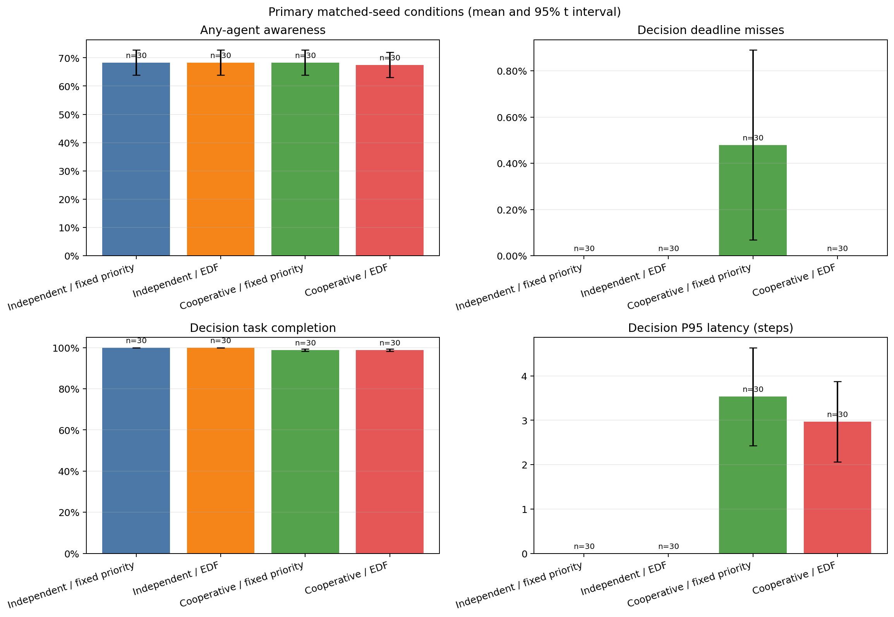
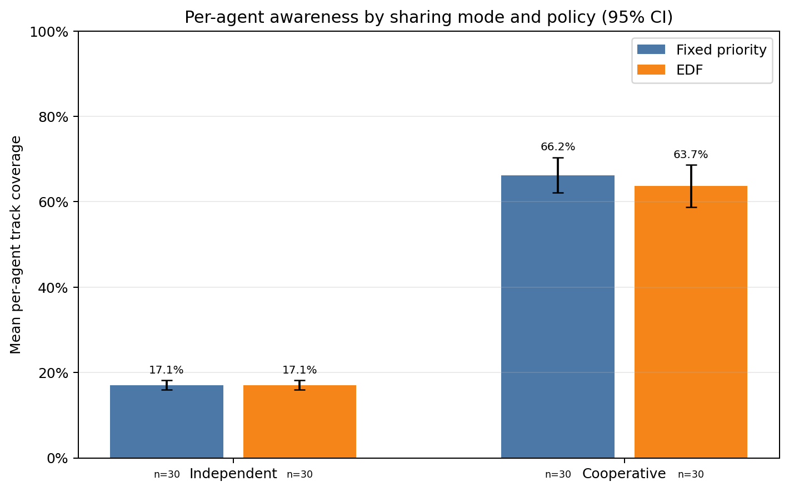
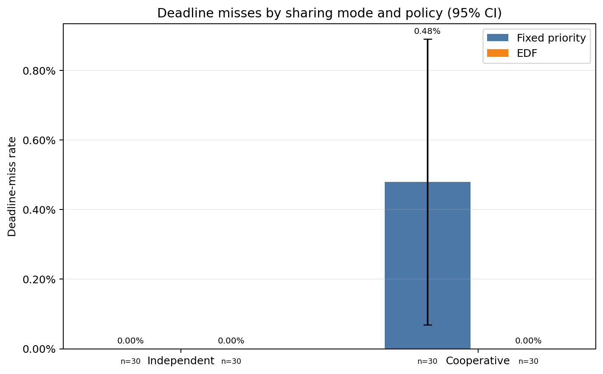
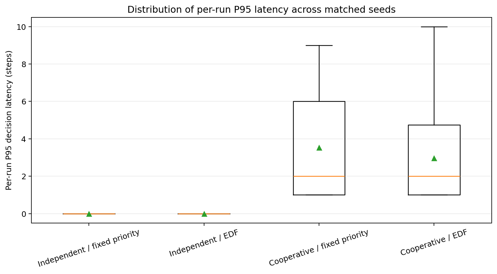
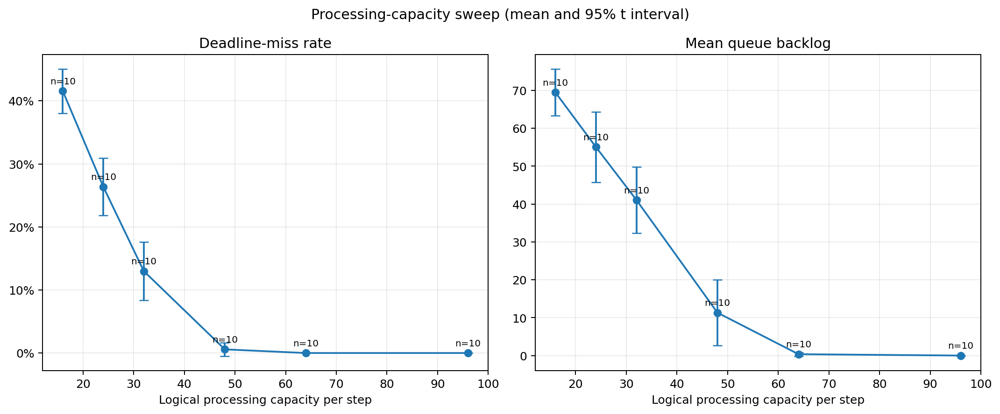
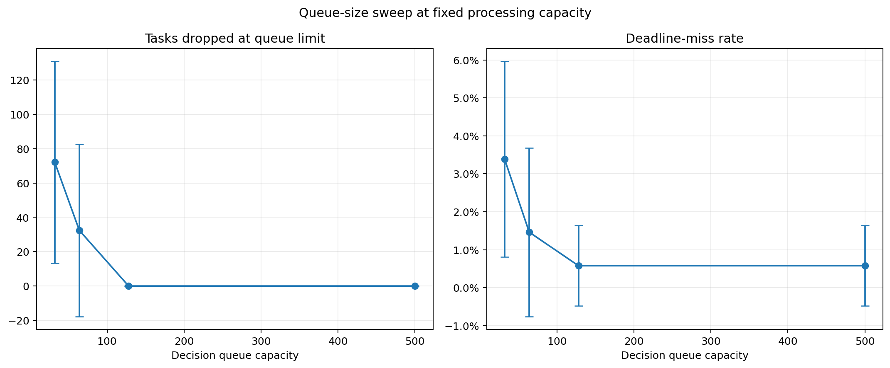
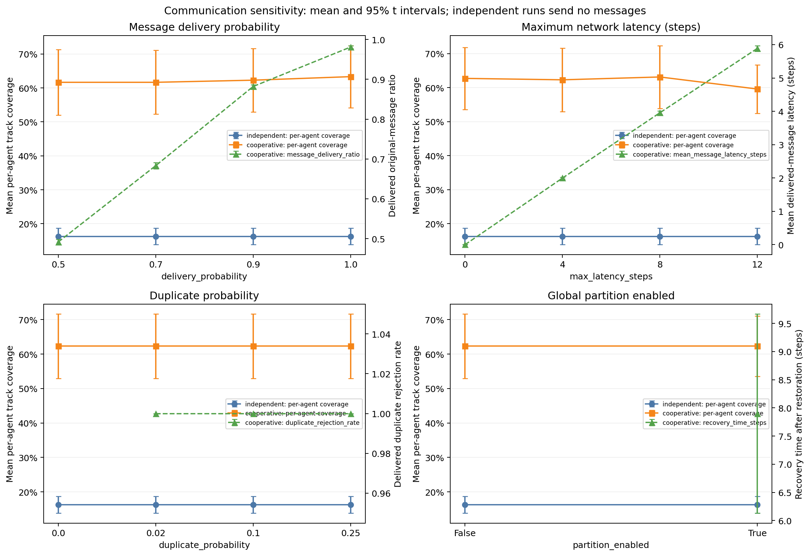
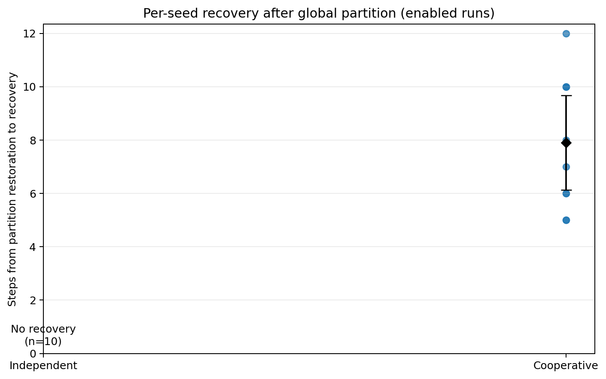
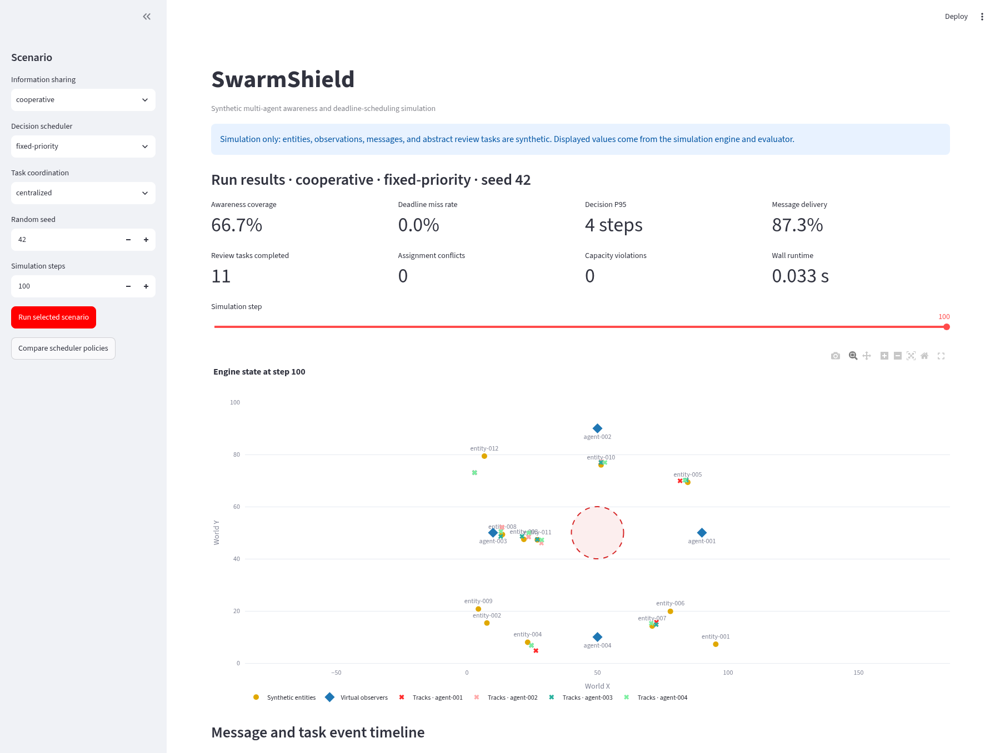
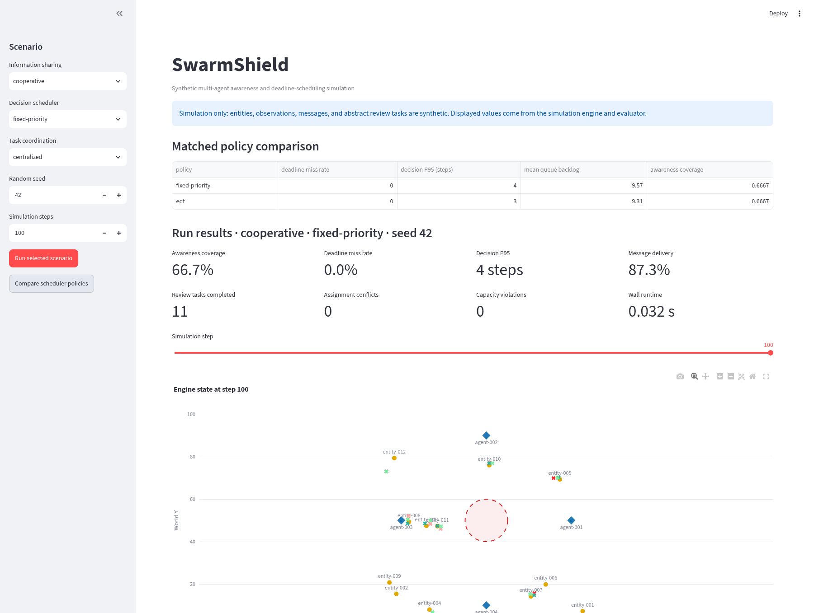

# SwarmShield — Experimental Results and Repository Verification

**Report date:** 2026-10-25  
**Project revision:** no Git metadata was present, so a commit ID could not be recorded.  
**Run directory:** [`verification_20261025_0915/`](verification_20261025_0915/)

## Executive summary

- Repository checks completed on Python 3.13.5. The existing test suite passed (24 tests), compilation passed, the documented cooperative baseline ran successfully, and the event log matched the pre-existing `output/events.csv` byte for byte.
- The primary experiment compared independent/cooperative sharing and fixed-priority/EDF scheduling over the same 30 seeds (42–71): 120 runs total. One-factor overload and communication sweeps added 490 runs over 10 seeds each. All 610 runs completed with no recorded failures.
- Cooperative sharing substantially increased the average fraction of entities tracked by each agent: 17.08% independently versus 66.25% with cooperative fixed-priority scheduling. The any-agent union coverage remained 68.33% in those two conditions. This is consistent with sharing redistributing already detected reports among agents; it does not mean more entities were first detected.
- At baseline load, EDF had no deadline misses in the 30 cooperative runs; fixed-priority averaged 0.48%. The paired-seed mean difference was −0.48 percentage points (95% t interval −0.89 to −0.07 points). EDF also reduced mean per-run P95 decision latency by 0.57 steps, while mean information age was 0.25 steps higher. This result is conditional on this simulator and baseline configuration.
- Overload behavior was most sensitive to logical throughput and arrival volume. At capacity 16, mean deadline misses were 41.57%; at 64 and 96 they were zero. Increasing queue capacity prevented admission drops but did not add service capacity; capacities 128 and 500 produced the same results in this sweep.
- Lower message delivery probability and longer latency changed message and per-agent track metrics in the expected directions in most comparisons. With the simulated global partition enabled, cooperative original-message delivery ratio fell from 88.21% to 56.06%; mean recovery under the simulator's shared-track-set criterion was 7.9 steps after restoration.
- These are synthetic software simulation results. They do not measure real sensors, radios, processors, field performance, or safety outcomes.

## 1. Verification environment and commands

The repository root was `/home/usualguy/SwarmShield`. The directory had no Git metadata (`git rev-parse --show-toplevel` failed), so the report identifies a run timestamp rather than a commit. Available versions used for verification and plots were Python 3.13.5, Matplotlib 3.10.1, Streamlit 1.66.1, Plotly 7.1.0, Selenium 4.31.1, Chromium 149.0.7827.114, and matching ChromeDriver 149.0.7827.114. The simulator and tests use the Python standard library; Matplotlib is an optional dependency for research plots and Streamlit/Plotly are optional dashboard dependencies.

Commands executed from the repository root:

```bash
python3 -m unittest discover -s tests -v
python3 -m compileall -q swarmshield experiments app.py
python3 -m swarmshield.runner \
  --config configs/baseline.json \
  --mode cooperative \
  --events experiments/results/verification_20261025_0915/baseline_events.csv \
  > experiments/results/verification_20261025_0915/baseline_summary.json
python3 experiments/run_research.py \
  --config configs/baseline.json \
  --output-dir experiments/results/verification_20261025_0915/matrix \
  --primary-seeds 30 \
  --sweep-seeds 10 \
  --start-seed 42
python3 experiments/analyze_research.py \
  --run-dir experiments/results/verification_20261025_0915/matrix
```

The test command passed all **24 tests**. Compilation exited successfully. The baseline CLI exited successfully. The research matrix exited successfully with **610 runs, 0 failed runs**, 120 primary runs, and 490 sweep runs; elapsed matrix runtime was 17.30 seconds on this host. Analysis produced 2,650 aggregate metric rows and 187 paired-comparison rows. Analysis was subsequently rerun with `--overwrite` after plot-label and recovery-interval fixes; it again completed for 610 runs and preserved `runs.jsonl`, `runs.csv`, and `sample_events/`.

The Streamlit dashboard responded successfully and was exercised in Chromium. It emitted Streamlit's non-blocking deprecation notice for `use_container_width`; the dashboard rendered and produced the screenshots linked below.

## 2. Repository and implementation verification

The inspected implementation has a synthetic 2D world, range/probability-based noisy observations, agent-local track stores, an in-process message simulator, a bounded logical decision scheduler, a separate abstract coordination manager, a CLI, a Streamlit dashboard, and standard-library tests. The dashboard reads results from the same simulation runner; it is not a separate simulation implementation.

Implementation details verified in source:

- The scheduler processes logical cost units per virtual step. Fixed-priority favors larger numeric priority, then earlier deadline; EDF sorts by earlier deadline and uses the same tie breakers. Neither policy represents CPU time or guarantees wall-clock deadlines.
- Queue capacity is a bound on active tasks. A submission at capacity is marked dropped. Expired tasks and queue-dropped tasks both count as misses when their deadline is within the horizon. Tasks with a future deadline at the horizon remain pending.
- Cooperative mode publishes completed local observations to the other agents. The network models per-recipient loss, integer-step latency, duplicates, and an optional global outage. It does not model a radio, spatial topology, protocol stack, or a distributed deployment.
- Coordination tasks are generic review work assigned to virtual resources. The current primary and sweep configurations use centralized coordination; decentralized conflict behavior was not tested in this matrix.
- The metric `mean_first_detection_delay_steps` averages the first observation-generation step for entities detected during the run. It is not the delay until a queued decision is applied, and entities never detected are excluded from the average and counted separately.
- `any_agent_awareness_coverage` counts the union of fresh tracked entity IDs. `mean_agent_track_coverage` averages each agent's fresh-track fraction. The latter exposes how shared reports change per-agent awareness when the union changes little.
- Network `message_delivery_ratio` divides original-message callbacks by original messages sent. A callback can return `queue_overload` and still be counted as network-delivered. The research runner therefore also records event-derived counts of original messages accepted into the decision queue and rejected by it. Those rejection counts were zero in the primary and communication matrices.

The existing baseline event file was not overwritten. A fresh baseline event file was written under the timestamped results directory and compared byte for byte with `output/events.csv`: the files were identical. Both contained 12,461 event rows, including 100 simulation snapshots. Baseline event counts matched the JSON summary: 1,713 originals sent, 1,496 callbacks delivered, and 184 originals dropped. The remaining 33 originals were pending at the horizon, so `sent = delivered + dropped + pending` held. Decision task statuses also reconciled: 2,066 completed + 0 expired + 0 overload-dropped + 1 pending = 2,067 created.

## 3. Baseline configuration and result

The baseline is seed 42, 100 simulation steps, a 100 × 100 world, 4 observers, 12 entities, detection range 25, detection probability 0.8, position-noise standard deviation 1, and maximum fresh-track age 10 steps. Network settings are delivery probability 0.9, maximum latency 4 steps, duplicate probability 0.02, and no partition. Scheduler settings are fixed-priority, 48 logical processing units per step, queue capacity 500, deadline offsets 4–12, processing costs 1–3, and priorities 1–3. Coordination is centralized, with resource capacity 2, task duration 3, task deadline 12, and queue capacity 100. The complete effective configuration is in [`baseline_config.json`](verification_20261025_0915/baseline_config.json).

The documented cooperative CLI run reported:

| Metric | Seed-42 result |
|---|---:|
| Any-agent awareness coverage | 66.67% |
| Mean per-agent track coverage | 66.67% |
| Mean first-observation step among detected entities | 5.91 steps |
| Entities never detected | 1 of 12 |
| Original messages sent / callbacks delivered / dropped / pending | 1,713 / 1,496 / 184 / 33 |
| Message delivery ratio / mean delivered-message latency | 87.33% / 1.96 steps |
| Duplicate copies scheduled / delivered / rejected | 27 / 25 / 25 |
| Decision tasks created / completed / expired / dropped / pending | 2,067 / 2,066 / 0 / 0 / 1 |
| Deadline-miss rate | 0% |
| Decision latency P50 / P95 / P99 | 0 / 4 / 8 steps |
| Mean / maximum decision backlog | 9.57 / 70 tasks |
| Mean information age at decision | 2.34 steps |
| Coordination tasks created / completed | 11 / 11 |
| Wall-clock runtime | 0.033 seconds |

The baseline summary is [`baseline_summary.json`](verification_20261025_0915/baseline_summary.json); the verified 12,461-row log is [`baseline_events.csv`](verification_20261025_0915/baseline_events.csv). Wall-clock runtime is host-specific and is not simulated time.

## 4. Experimental questions and method

The analysis asked whether cooperative sharing changes local track coverage, whether scheduler policy changes deadline and latency outcomes, which workload factors drive queueing and misses, and how message degradation/partition settings affect communication and fresh tracks. These were working questions, not preregistered hypotheses.

### Primary matrix

Four conditions were compared: independent/fixed-priority, independent/EDF, cooperative/fixed-priority, and cooperative/EDF. All used the baseline settings except mode, policy, and seed. Each condition used seeds 42–71 (30 per condition). The primary total is 120 runs.

The same seed and base scenario were used in each matched comparison. The engine derives separate seeded streams for world motion, observations, network faults, and scheduler work, which prevents one subsystem's draws from shifting another subsystem's stream. However, cooperative runs submit more decision tasks than independent runs. That changes how many sequential random workload values are consumed by the task stream, so matching seeds does **not** guarantee identical task-level costs, priorities, or deadlines between those modes. Paired differences below are by seed and configuration, not by identical per-task workload.

### One-factor sweeps

The overload sweeps used cooperative mode, fixed-priority, the baseline settings, and seeds 42–51. Each level changed one parameter while keeping the others at baseline:

- Processing capacity: 16, 24, 32, 48, 64, 96 logical units per step.
- Queue capacity: 32, 64, 128, 500 tasks.
- Entity count: 6, 12, 24, 36.
- Maximum task processing cost: 1, 3, 6.
- Maximum task deadline offset: 4, 8, 12, 24 steps.

This is 21 levels × 10 seeds = 210 runs. The communication sweeps used the same 10 seeds and fixed-priority policy, with independent and cooperative modes at each level:

- Delivery probability: 0.5, 0.7, 0.9, 1.0.
- Maximum latency: 0, 4, 8, 12 steps.
- Duplicate probability: 0, 0.02, 0.1, 0.25.
- Global partition: disabled or enabled.

This is 14 levels × 2 modes × 10 seeds = 280 runs. The total sweep count is 490. These experiments isolate one factor at a time; they do not estimate interactions between factors.

### Statistical summaries

The analysis records sample count, arithmetic mean, sample standard deviation, median, linearly interpolated quartiles/IQR, minimum, maximum, and a 95% two-sided Student-t interval for each numeric metric/group. Critical values are tabulated for n=10 and n=30 and use a Cornish–Fisher approximation otherwise. Paired comparisons subtract the two condition outcomes for each seed first, then summarize those differences. No p-values or multiple-comparison adjustments are reported.

The t intervals assume independent seed-level outcomes and are descriptive. Some measures are bounded proportions or nonnegative counts, and their untransformed intervals can extend outside the valid range; such endpoints are not physically meaningful. This occurs in the exported full statistics. The displayed primary results focus on the mean and interval; the raw analysis CSV contains every distribution statistic. P50/P95/P99 are computed within each run from completed decision-task latencies, then summarized across runs. They are virtual steps, not milliseconds. The message-latency mean includes delivered original messages only; it excludes dropped and still-pending messages.

## 5. Primary results

Each cell below gives a mean and its across-seed 95% t interval (`n=30`). “n/a” means the run mode sent no peer messages, not that its delivery ratio was zero.

### Awareness and communication

| Condition | Any-agent coverage | Mean per-agent track coverage | First-observation step | Original-message delivery ratio | Mean delivered-message latency |
|---|---:|---:|---:|---:|---:|
| Independent / fixed priority | 68.33% (63.90–72.76) | 17.08% (15.98–18.19) | 12.984 (10.659–15.308) steps | n/a | n/a |
| Independent / EDF | 68.33% (63.90–72.76) | 17.08% (15.98–18.19) | 12.984 (10.659–15.308) steps | n/a | n/a |
| Cooperative / fixed priority | 68.33% (63.90–72.76) | 66.25% (62.09–70.41) | 12.984 (10.659–15.308) steps | 88.34% (88.06–88.63) | 1.987 (1.974–2.000) steps |
| Cooperative / EDF | 67.50% (63.07–71.93) | 63.75% (58.81–68.69) | 12.984 (10.659–15.308) steps | 88.40% (88.12–88.67) | 1.987 (1.974–2.000) steps |

The first-observation-step result is identical because observations are generated before the scheduler acts and the metric is recorded at observation generation. The any-agent union is also the same for independent and cooperative fixed-priority runs; sharing mainly changes how many fresh tracks each agent holds. Do not read the per-agent coverage increase as an increase in sensor detections.

### Decision scheduling and task lifecycle

| Condition | Deadline-miss rate | Decision task completion rate | Completed / expired / dropped / pending tasks (mean per run) |
|---|---:|---:|---:|
| Independent / fixed priority | 0.00% (0.00–0.00) | 100.00% (100.00–100.00) | 566.33 / 0 / 0 / 0 |
| Independent / EDF | 0.00% (0.00–0.00) | 100.00% (100.00–100.00) | 566.33 / 0 / 0 / 0 |
| Cooperative / fixed priority | 0.480% (0.069–0.890) | 98.803% (98.264–99.341) | 2,022.17 / 10.37 / 0 / 16.53 |
| Cooperative / EDF | 0.000% (0.000–0.000) | 98.869% (98.288–99.451) | 2,025.13 / 0 / 0 / 25.57 |

| Condition | P50 / P95 / P99 decision latency (mean across runs, steps) | Mean / maximum queue backlog (tasks per run) | Mean information age at decision (steps) | Mean wall runtime (seconds) |
|---|---:|---:|---:|---:|
| Independent / fixed priority | 0 / 0 / 0 | 0.00 / 9.10 | 0.000 | 0.00978 |
| Independent / EDF | 0 / 0 / 0 | 0.00 / 9.10 | 0.000 | 0.00964 |
| Cooperative / fixed priority | 0 / 3.53 / 5.43 | 11.34 / 62.20 | 2.360 | 0.03052 |
| Cooperative / EDF | 0.27 / 2.97 / 4.00 | 14.13 / 69.33 | 2.610 | 0.03055 |

The cooperative conditions created roughly 2,050 decision tasks per run versus 566 in independent mode, mostly because reports from peers also enter the decision queue. At these baseline settings, neither condition dropped decision tasks due to queue capacity. Independent-mode task durations are zero because local observation tasks can be processed in their creation step at this capacity. Coordination completion averaged 99.70% across all primary conditions; mean assignment conflicts and capacity violations were zero. This matrix used centralized coordination, so it does not evaluate decentralized proposal conflicts.

### Paired-seed differences

Differences are left condition minus right condition, computed per seed (`n=30`) before the mean interval.

| Comparison | Metric | Mean paired difference | 95% t interval |
|---|---|---:|---:|
| Cooperative − independent, fixed priority | Mean per-agent track coverage | +49.17 percentage points | +46.07 to +52.26 points |
| Cooperative − independent, fixed priority | Any-agent coverage | 0.00 points | 0.00 to 0.00 points |
| Cooperative − independent, fixed priority | Deadline-miss rate | +0.480 points | +0.069 to +0.890 points |
| Cooperative − independent, fixed priority | Decision task completion rate | −1.197 points | −1.736 to −0.659 points |
| EDF − fixed priority, cooperative | Deadline-miss rate | −0.480 points | −0.890 to −0.069 points |
| EDF − fixed priority, cooperative | Per-run P95 decision latency | −0.567 steps | −0.916 to −0.217 steps |
| EDF − fixed priority, cooperative | Per-run P99 decision latency | −1.433 steps | −2.019 to −0.848 steps |
| EDF − fixed priority, cooperative | Mean information age | +0.249 steps | +0.004 to +0.495 steps |
| EDF − fixed priority, cooperative | Mean per-agent track coverage | −2.50 points | −5.23 to +0.23 points |
| EDF − fixed priority, cooperative | Any-agent coverage | −0.83 points | −1.78 to +0.12 points |

Independent fixed-priority and EDF behavioral outcomes were identical across these 30 baseline seeds; the small runtime difference is host timing. In cooperative mode, EDF's mean deadline-miss and P95 differences favor EDF within this experiment, while information age is slightly higher. The awareness intervals for cooperative EDF versus fixed priority overlap zero in the paired analysis. These findings do not establish a universal scheduler ranking, and no causal claim is made beyond the simulator's controlled configuration.

The four-condition comparison is visualized below. Error bars show the untransformed mean 95% t interval; the sample size is printed on the plot.









## 6. Processing overload results

Each row is the mean of 10 seeds, with cooperative fixed-priority mode. The standard baseline workload was used except for the factor in the first column. “Dropped” means rejected at the decision queue limit. These tables show means; the full statistics export includes 95% intervals and distribution summaries for every metric.

### Logical processing capacity

| Capacity units per step | Miss rate | Completed | Expired | Dropped | Pending | Mean backlog | Max backlog | P95 latency (steps) | Info age (steps) |
|---:|---:|---:|---:|---:|---:|---:|---:|---:|---:|
| 16 | 41.57% | 793.50 | 541.70 | 0 | 71.20 | 69.49 | 113.10 | 10.50 | 5.20 |
| 24 | 26.38% | 1,188.30 | 407.70 | 0 | 46.10 | 55.07 | 104.60 | 8.40 | 3.89 |
| 32 | 12.99% | 1,567.50 | 227.90 | 0 | 44.40 | 41.08 | 90.10 | 9.00 | 3.75 |
| 48 | 0.58% | 2,024.00 | 12.40 | 0 | 10.10 | 11.32 | 65.80 | 3.70 | 2.42 |
| 64 | 0.00% | 2,061.20 | 0 | 0 | 2.30 | 0.36 | 37.70 | 1.00 | 1.62 |
| 96 | 0.00% | 2,061.20 | 0 | 0 | 2.30 | 0.00 | 36.80 | 1.00 | 1.60 |

### Queue capacity

| Queue capacity (tasks) | Miss rate | Completed | Expired | Decision tasks dropped at limit | Network callbacks rejected by decision queue | Pending | Mean backlog | Max backlog |
|---:|---:|---:|---:|---:|---:|---:|---:|---:|
| 32 | 3.39% | 1,987.10 | 0 | 72.20 | 72.20 | 2.80 | 2.17 | 32.00 |
| 64 | 1.46% | 2,018.40 | 0 | 32.40 | 32.40 | 8.10 | 8.74 | 55.10 |
| 128 | 0.58% | 2,024.00 | 12.40 | 0 | 0 | 10.10 | 11.32 | 65.80 |
| 500 | 0.58% | 2,024.00 | 12.40 | 0 | 0 | 10.10 | 11.32 | 65.80 |

### Arrival volume, task cost, and deadline range

| Factor | Level | Miss rate | Completed | Expired | Dropped | Pending | P95 latency (steps) | Mean backlog | Info age (steps) |
|---|---:|---:|---:|---:|---:|---:|---:|---:|---:|
| Entity count | 6 | 0.00% | 1,071.40 | 0 | 0 | 0.90 | 1.00 | 0.01 | 1.60 |
| Entity count | 12 | 0.58% | 2,024.00 | 12.40 | 0 | 10.10 | 3.70 | 11.32 | 2.42 |
| Entity count | 24 | 26.47% | 2,382.40 | 804.80 | 0 | 100.10 | 8.60 | 98.97 | 3.25 |
| Entity count | 36 | 41.90% | 2,392.20 | 1,651.20 | 0 | 226.80 | 11.00 | 220.26 | 5.96 |
| Maximum task cost | 1 | 0.00% | 2,061.20 | 0 | 0 | 2.30 | 1.00 | 0.00 | 1.60 |
| Maximum task cost | 3 | 0.58% | 2,024.00 | 12.40 | 0 | 10.10 | 3.70 | 11.32 | 2.42 |
| Maximum task cost | 6 | 20.41% | 1,353.80 | 333.20 | 0 | 42.90 | 8.60 | 48.13 | 3.67 |
| Maximum deadline offset (steps) | 4 | 1.44% | 2,013.10 | 31.60 | 0 | 7.50 | 2.70 | 8.38 | 2.12 |
| Maximum deadline offset (steps) | 8 | 0.68% | 2,021.70 | 15.00 | 0 | 11.20 | 3.10 | 9.50 | 2.29 |
| Maximum deadline offset (steps) | 12 | 0.58% | 2,024.00 | 12.40 | 0 | 10.10 | 3.70 | 11.32 | 2.42 |
| Maximum deadline offset (steps) | 24 | 0.31% | 2,029.70 | 6.30 | 0 | 14.30 | 4.80 | 14.99 | 2.64 |

Increasing logical throughput reduced misses, queue backlog, P95 latency, and information age in this workload. At 64 and 96 units the mean number of completed tasks was identical; extra capacity above 64 did not improve the observed completion count. Raising queue capacity from 32 to 128 reduced admission drops, but queue capacity 128 and 500 produced the same outcomes. A larger queue creates room for waiting work; it does not increase the 48-unit service budget. At high entity counts, completed work leveled near 2,390 tasks while expired tasks and backlog grew, consistent with arrivals exceeding available logical processing capacity. Tightening deadlines increased misses, while extending deadlines reduced expirations but increased latency/backlog. These are one-factor results; interactions were not measured.





## 7. Communication degradation and recovery

For communication comparisons, each level used the same 10 seeds in independent and cooperative modes. Cooperative mode used the baseline fixed-priority policy. Independent mode sent no peer messages, so its message ratio, message latency, and message-based recovery are undefined. In the tables below, “coverage” is mean per-agent track coverage. The network ratio is for original messages; duplicate copies are counted separately.

### Delivery probability

| Configured probability | Independent coverage | Cooperative coverage | Cooperative original-message delivery ratio | Mean delivered latency (steps) | Originals dropped per run |
|---:|---:|---:|---:|---:|---:|
| 0.5 | 16.25% | 61.67% | 49.17% | 1.983 | 848.5 |
| 0.7 | 16.25% | 61.67% | 68.32% | 1.988 | 516.7 |
| 0.9 | 16.25% | 62.29% | 88.21% | 1.998 | 168.6 |
| 1.0 | 16.25% | 63.33% | 98.11% | 1.994 | 0 |

The observed delivery ratio is lower than the configured probability in some runs because dropped and horizon-pending original messages both remain in the sent-message denominator. It is not a per-link reliability estimate from a physical network.

### Maximum message latency

| Maximum latency (steps) | Independent coverage | Cooperative coverage | Cooperative delivery ratio | Mean delivered latency (steps) | Mean information age (steps) | Cooperative any-agent coverage |
|---:|---:|---:|---:|---:|---:|---:|
| 0 | 16.25% | 62.71% | 89.71% | 0.000 | 1.648 | 65.00% |
| 4 | 16.25% | 62.29% | 88.21% | 1.998 | 2.419 | 65.00% |
| 8 | 16.25% | 63.13% | 86.53% | 3.957 | 3.723 | 65.00% |
| 12 | 16.25% | 59.58% | 84.90% | 5.888 | 4.985 | 64.17% |

As the configured maximum increased, the mean latency among delivered originals and the measured information age rose. At 12 steps, cooperative any-agent coverage was slightly lower. Information age is calculated only for completed decision tasks; it should not be interpreted alone because outage/loss also changes which reports arrive and which tasks complete.

### Duplicate probability

| Duplicate probability | Cooperative coverage | Originals delivery ratio | Duplicate copies scheduled / delivered / rejected per run | Rejection rate among delivered copies |
|---:|---:|---:|---:|---:|
| 0 | 62.29% | 88.21% | 0 / 0 / 0 | n/a (no copies delivered) |
| 0.02 | 62.29% | 88.21% | 31.2 / 30.5 / 30.5 | 100% |
| 0.1 | 62.29% | 88.21% | 153.5 / 150.8 / 150.8 | 100% |
| 0.25 | 62.29% | 88.21% | 385.5 / 377.8 / 377.8 | 100% |

The delivered duplicate copies were rejected by message-ID deduplication in these runs. Increasing duplicate probability did not change the reported mean per-agent coverage or original-message delivery ratio at these levels. Rejection rate is undefined when no duplicate copy is delivered.

### Global partition and recovery

| Partition | Mode | Any-agent coverage | Mean per-agent coverage | Original delivery ratio | Originals dropped per run | Recovery result |
|---|---|---:|---:|---:|---:|---|
| Off | Independent | 65.00% | 16.25% | n/a | n/a | n/a |
| Off | Cooperative | 65.00% | 62.29% | 88.21% | 168.6 | n/a |
| On | Independent | 65.00% | 16.25% | n/a | n/a | Criterion not reached in 10 runs |
| On | Cooperative | 64.17% | 62.29% | 56.06% | 719.1 | 7.9 steps mean (95% CI 6.13–9.67, n=10) |

The configured outage is global and spans approximately one-third to two-thirds of the 100-step horizon. Cooperative recovery is defined by the first post-restoration step at which all agents hold the same non-empty set of fresh entity IDs. Independent mode has no shared reports, so failure to meet that equality criterion is not evidence that an independent network failed to recover; the criterion is not applicable to the intended independent behavior. The recovery value does not measure position accuracy or real-network restoration.





## 8. Dashboard screenshots

These are screenshots from the actual Streamlit dashboard running the project engine in Chromium, not mockups. The first shows seed 42, cooperative mode, fixed-priority scheduling, and the generated metric cards/world view. The second shows the dashboard's actual fixed-priority/EDF comparison table for that selected cooperative scenario.





## 9. Bugs, metric caveats, and changes

No simulation-engine defect requiring a behavioral fix was confirmed in this investigation. The baseline event file and its summary reconciled, and all experiment records passed consistency checks for seeds, effective mode/policy/configuration, task lifecycle totals, and original-message accounting.

Two figure presentation defects were found and corrected in `experiments/analyze_research.py`: manually assigned legends could show the wrong policy colors in the awareness/deadline charts, and the partition chart used a one-sided interval and placed the “no recovery” text outside its plotted range. The awareness comparison now shows the metric that responds to sharing (mean per-agent track coverage), the policy legend is explicit, and recovery intervals/labels render correctly. Statistics and raw simulations did not change; analysis was regenerated after these fixes.

The network ratio is specifically callback delivery, not successful decision-queue admission. The saved records include event-derived `original_messages_queued_for_decision` and `original_messages_rejected_by_decision_queue`. Rejections were zero in the 120 primary and 280 communication runs, but **1,046 original-message callbacks were rejected by the decision queue in 16 of the overload runs**: queue capacity 32 averaged 72.2 rejections per run (maximum 283), and capacity 64 averaged 32.4 (maximum 223). Capacities 128 and 500 had none. This is why a network callback counted as delivered must not be equated with a report accepted for reconciliation. Mean detection step excludes entities never detected; inspect `entities_never_detected` alongside it. Coordination conflict results are limited to centralized coordination. The 95% t intervals are not transformed for bounded or nonnegative metrics and can have impossible endpoints.

## 10. Limitations and threats to validity

- The world, agents, observations, faults, and processing costs are synthetic. No physical sensor/radio/processor calibration was performed.
- A single baseline parameterization was used for the primary matrix. Results can change under other ranges, horizons, or interaction effects.
- Seeds are paired at the scenario level, but cooperative task arrivals shift later draws in the sequential scheduler-workload stream. Pairing does not enforce identical task costs/deadlines across modes.
- The 10-seed one-factor sweeps provide limited precision. The intervals are descriptive t intervals and may be poor for skewed, zero-inflated, bounded, or discrete outcomes. No multiple-comparison correction or formal hypothesis testing was applied.
- Wall runtime depends on host, load, and interpreter. Sub-0.1-second runs do not establish real-time execution performance.
- Decision-task latencies are measured in virtual steps and only completed tasks contribute. Pending, expired, and dropped tasks are separately counted.
- Message latency averages only delivered original messages. Dropped and pending messages do not contribute to that mean.
- The recovery criterion requires exact equality of all agents' non-empty fresh-track ID sets. It is a simulator-specific convergence check, not a general measure of network or system recovery.
- Sample event CSVs were retained for one representative seed (42) per primary condition and sweep level (53 files). Per-run metrics and effective configurations are retained for every seed; event histories were not saved for all 610 runs.
- The app currently emits a Streamlit deprecation notice for `use_container_width`. It did not prevent dashboard operation or screenshot capture.

## 11. Reproduction and generated artifacts

From the repository root, use a new output directory for each full simulation matrix:

```bash
python3 -m pip install -r requirements-analysis.txt
python3 experiments/run_research.py \
  --config configs/baseline.json \
  --output-dir experiments/results/reproduction_01/matrix \
  --primary-seeds 30 \
  --sweep-seeds 10 \
  --start-seed 42
python3 experiments/analyze_research.py \
  --run-dir experiments/results/reproduction_01/matrix
```

The runner refuses to create an already-existing output directory. To recalculate statistics and figures in an existing matrix directory, use:

```bash
python3 experiments/analyze_research.py \
  --run-dir experiments/results/reproduction_01/matrix \
  --overwrite
```

`--overwrite` replaces only known analyzer-generated CSV/JSON/PNG/SVG files. It preserves raw run records and sample event CSVs. `runs.jsonl` stores every run summary and effective configuration. `runs.csv` provides a flattened per-run table. `run_plan.json` records factors and levels; `manifest.json` records counts and environment. `sample_events/` contains representative event histories. `aggregate_statistics.csv`, `paired_primary_differences.csv`, `analysis_summary.json`, and `figures/` are generated by the analysis script.

### Artifacts from this verification

- [Baseline effective configuration](verification_20261025_0915/baseline_config.json)
- [Baseline CLI summary](verification_20261025_0915/baseline_summary.json)
- [Baseline CSV event log](verification_20261025_0915/baseline_events.csv)
- [Repository and experiment consistency checks](verification_20261025_0915/verification_checks.json)
- [Matrix manifest](verification_20261025_0915/matrix/manifest.json)
- [Run plan and factor levels](verification_20261025_0915/matrix/run_plan.json)
- [All 610 full per-run JSON records](verification_20261025_0915/matrix/runs.jsonl)
- [All 610 flattened per-run CSV records](verification_20261025_0915/matrix/runs.csv)
- [All group metric statistics](verification_20261025_0915/matrix/aggregate_statistics.csv)
- [Paired primary differences](verification_20261025_0915/matrix/paired_primary_differences.csv)
- [Analysis summary](verification_20261025_0915/matrix/analysis_summary.json)
- [Representative event-log directory](verification_20261025_0915/matrix/sample_events/) (53 CSV files)
- [Actual dashboard run screenshot](verification_20261025_0915/screenshots/dashboard_run.png)
- [Actual dashboard policy comparison screenshot](verification_20261025_0915/screenshots/dashboard_policy_comparison.png)
- Eight PNG and eight SVG plots are in [`matrix/figures/`](verification_20261025_0915/matrix/figures/).

The verification artifact directory is approximately 70 MiB, primarily because each representative event file includes per-step state snapshots.

## 12. Prioritized next steps

1. If stronger scheduler claims are needed, run more seeds and workload levels around the observed capacity transition; report paired per-seed effects and use intervals appropriate for bounded miss rates.
2. Add controlled interaction experiments (for example entity count × processing capacity and latency × delivery probability) after the one-factor response has been validated.
3. Save full event histories only for selected diagnostic seeds or compress them; the current sample events consume roughly 64 MiB.
4. Add a dedicated metric for messages accepted by the decision queue if application-level report acceptance is a first-class outcome. Keep network callback delivery as a separate transport-level measure.
5. Test decentralized coordination and conflict resolution separately; the current experiment matrix uses centralized coordination.
6. Replace deprecated Streamlit `use_container_width` arguments with the supported width argument when the dashboard is next updated.

## Conclusion

The repository's current baseline behavior, event output, automated tests, and dashboard were verified. Across 30 matched seeds, cooperative sharing was associated with substantially higher mean per-agent fresh-track coverage, while the any-agent union and first-observation timing changed little. In the cooperative baseline, EDF had lower measured deadline misses and P95/P99 decision latency than fixed-priority, with a modest increase in information age. The 10-seed sweeps show that logical throughput, arrival volume, and processing cost strongly affect backlog and misses; queue capacity controls admission drops but does not add processing throughput. Communication losses, delays, and partitions changed simulated message delivery and track metrics, with a mean 7.9-step cooperative convergence under the defined recovery criterion. These results establish how this implementation behaves under the tested synthetic configurations. They suggest where follow-up simulator experiments should focus. They do not establish real-world accuracy, radio performance, real-time guarantees, or deployment effectiveness.
